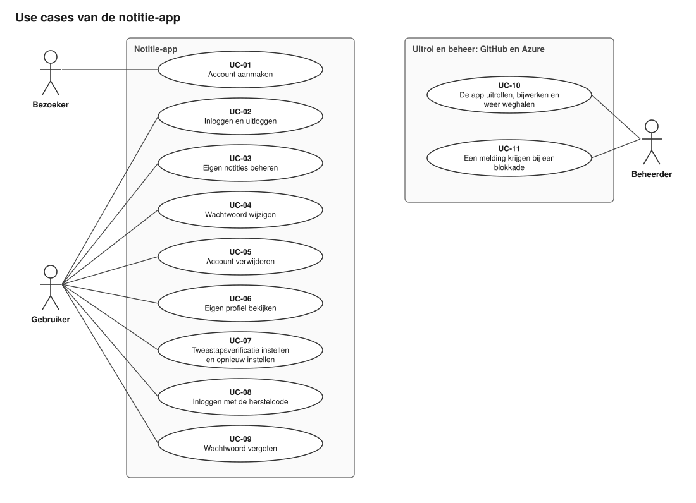
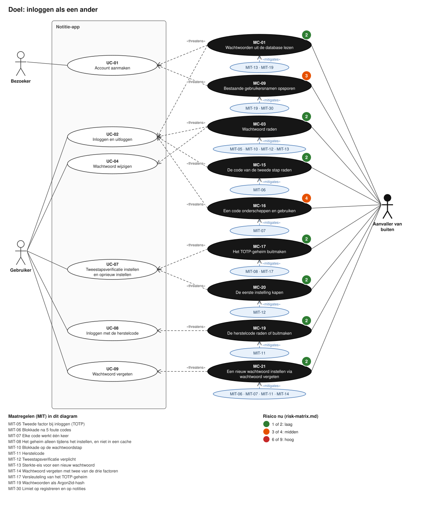
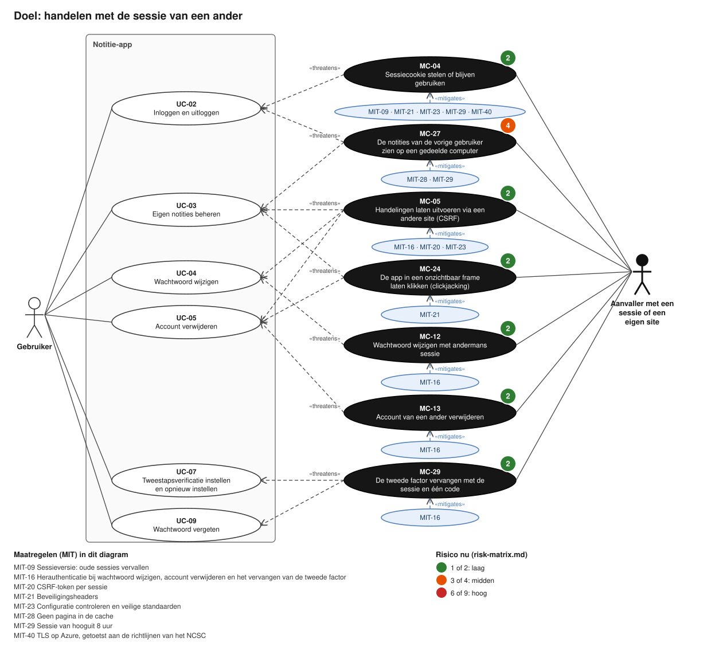
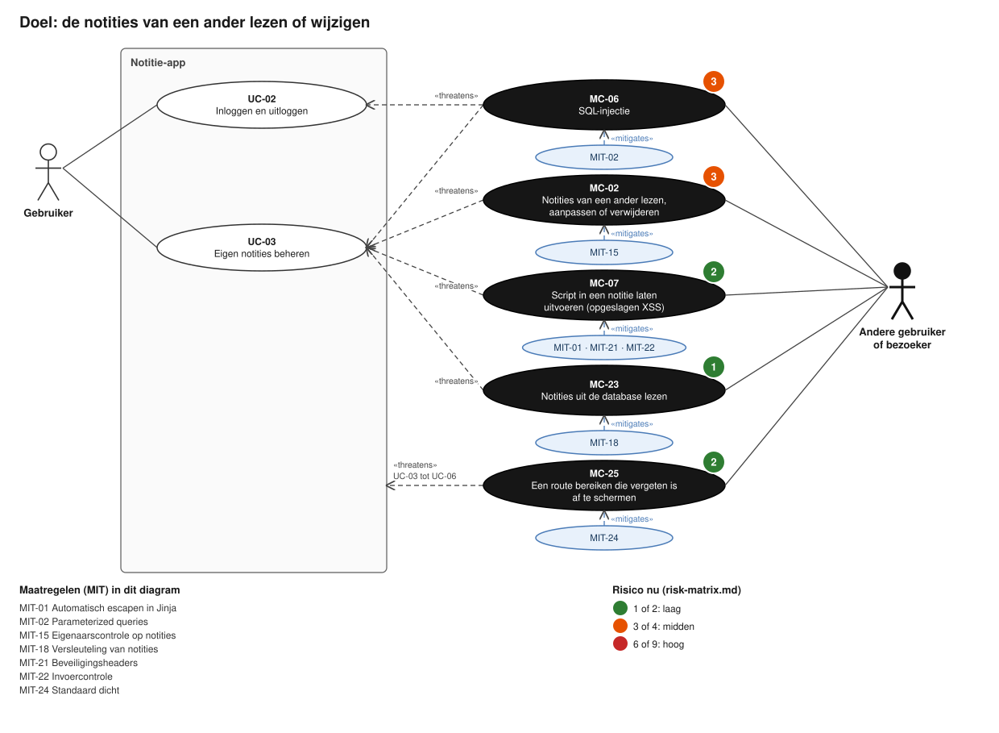
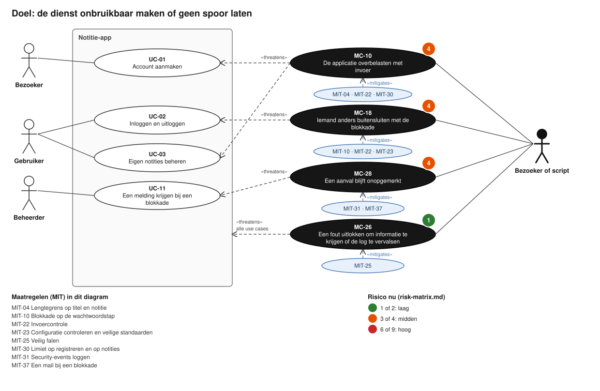
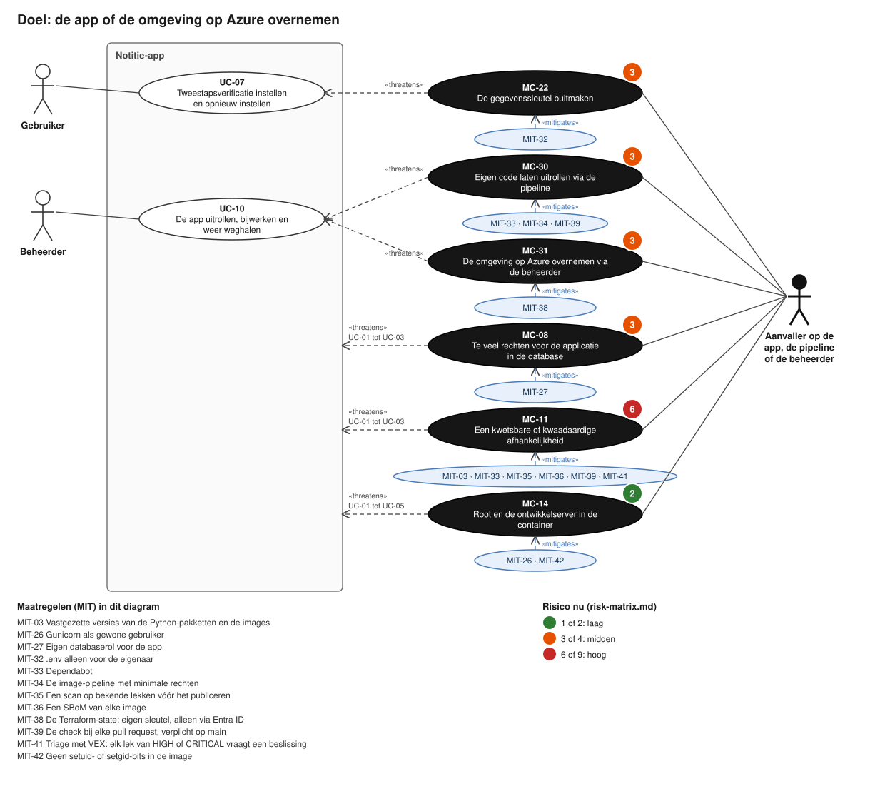

# Use case- en misuse case-diagrammen

Eerst het use case-diagram, daarna per doel van de aanvaller een misuse case-diagram: de use cases die hij bedreigt,
de aanvaller, de aanvallen (misuse cases) en de maatregelen ertegen. Samen staan alle 31 misuse cases erin, elk één
keer. De doelen volgen `../attack-trees.md`; het doel "als een ander handelen" is in tweeën gesplitst, inloggen en de
sessie, anders past het niet op één diagram.

## Notatie

Naar de misuse cases van Sindre en Opdahl (2005):

- **Wit ovaal:** een use case. **Zwart ovaal:** een misuse case.
- **Wit poppetje:** een bezoeker, gebruiker of beheerder. **Zwart poppetje:** de aanvaller (misuser).
- **«threatens»:** de misuse case bedreigt de use case, volgens "Gerelateerde use case" in `../entries.md`. Een pijl
  naar de rand van de app betekent dat de entry een reeks noemt ("UC-01 tot UC-03") of alle use cases.
- **Blauw ovaal met «mitigates»:** de maatregelen die de misuse case tegenhouden, volgens "Mitigaties" in de entry.
  Onder elk diagram staan ze met hun naam.
- **Het getal op een misuse case:** het risico nu, uit `../risk-matrix.md`: groen laag, oranje midden, rood hoog.

## De diagrammen

De use cases, met wie ze uitvoert:



Inloggen als een ander: raden, onderscheppen en de herstelwegen.



Handelen met de sessie van een ander, of via een andere site.



De notities van een ander lezen of wijzigen.



De dienst onbruikbaar maken, of een aanval zonder spoor.



De app, de pipeline of de omgeving op Azure overnemen. Hier staat de enige hoge: MC-11.



## Opnieuw tekenen

Na een wijziging in `../entries.md` of `../risk-matrix.md`, vanuit deze map, op Windows en Linux:

```
python make_diagrams.py
```

Het script gebruikt alleen de standaardbibliotheek. Een nieuwe misuse case moet eerst bij een doel in `GROUPS`
komen; anders stopt het script met een melding.

## Bron

Sindre, G., & Opdahl, A. L. (2005). Eliciting security requirements with misuse cases. *Requirements Engineering,
10*(1), 34-44.
